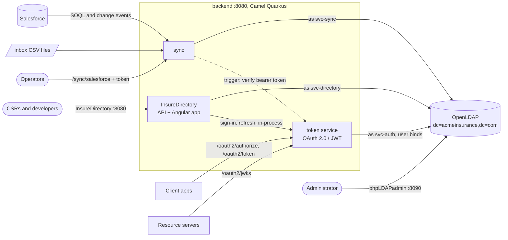

# Documentation

The project overview, setup and operations guide is [README.md](../README.md) at
the repository root. Everything else lives here.

## Requirements

- [LDAP_Schema_Definition.md](LDAP_Schema_Definition.md): the directory schema, the user
  types and what each type may hold. This is the requirements document the code
  follows.

## Sequence diagrams

The diagrams are Mermaid, embedded in Markdown, and render on GitHub, GitLab and
in VS Code (with a Mermaid preview extension).

| Document | Covers |
|---|---|
| [Salesforce sync](sequence/salesforce-sync.md) | Triggers (nightly, startup, HTTP, change events), the account tree, agents, and safe removal |
| [CSV intake](sequence/csv-intake.md) | Internal, member and other users from the `inbox/` drop folders |
| [OAuth: authorization code + PKCE](sequence/oauth-authorization-code.md) | Browser sign-in, the forced password change, and token contents |
| [OAuth: password grant](sequence/oauth-password-grant.md) | Confidential server-side clients |
| [OAuth: refresh token](sequence/oauth-refresh-token.md) | Refresh checks against LDAP, and token lifetimes |
| [OpenLDAP startup](sequence/openldap-startup.md) | First-start bootstrap, phpLDAPadmin, and the order services start in |
| [InsureDirectory](sequence/insure-directory.md) | Sign-in through the token service (backend for frontend), an API call, and what each source allows |

## API reference (OpenAPI)

Generated by the running backend (start it with `podman-compose up -d`):

| Covers | Spec | Swagger UI |
|---|---|---|
| Camel REST APIs: the sync trigger (`/sync`), InsureDirectory (`/auth`, `/api`) | http://localhost:8080/openapi | dev mode only |
| Token service (`/oauth2`, `/.well-known`) | http://localhost:8080/q/openapi | dev mode only |

The sync operations are always listed. They need a bearer token with `sync: run-sync`; with the Salesforce sync
turned off (`SF_ENABLED=false`) they answer 503.

## System overview

The backend is one Quarkus app (port 8080) with three parts. Each binds to the directory as its own service
account, so OpenLDAP's ACLs keep them apart.

