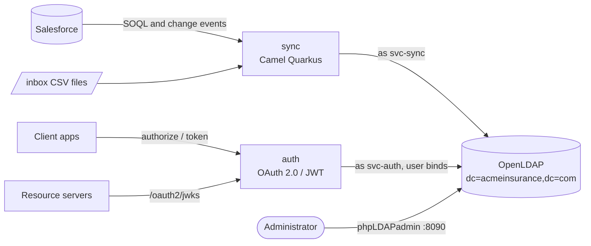

# Documentation

The project overview, setup and operations guide is [README.md](../README.md) at
the repository root. Everything else lives here.

## Requirements

- [LDAP_Schema_Definition.md](LDAP_Schema_Definition.md): the directory schema, the user
  types and what each type may hold. This is the requirements document the code
  follows.

## Sequence diagrams

The diagrams are Mermaid, embedded in Markdown, and render on GitHub, GitLab and
in VS Code (with a Mermaid preview extension).

| Document | Covers |
|---|---|
| [Salesforce sync](sequence/salesforce-sync.md) | Triggers (nightly, startup, HTTP, change events), the account tree, agents, and safe removal |
| [CSV intake](sequence/csv-intake.md) | Internal, member and other users from the `inbox/` drop folders |
| [OAuth: authorization code + PKCE](sequence/oauth-authorization-code.md) | Browser sign-in, the forced password change, and token contents |
| [OAuth: password grant](sequence/oauth-password-grant.md) | Confidential server-side clients |
| [OAuth: refresh token](sequence/oauth-refresh-token.md) | Refresh checks against LDAP, and token lifetimes |
| [OpenLDAP startup](sequence/openldap-startup.md) | First-start bootstrap, phpLDAPadmin, and the order services start in |

## System overview

