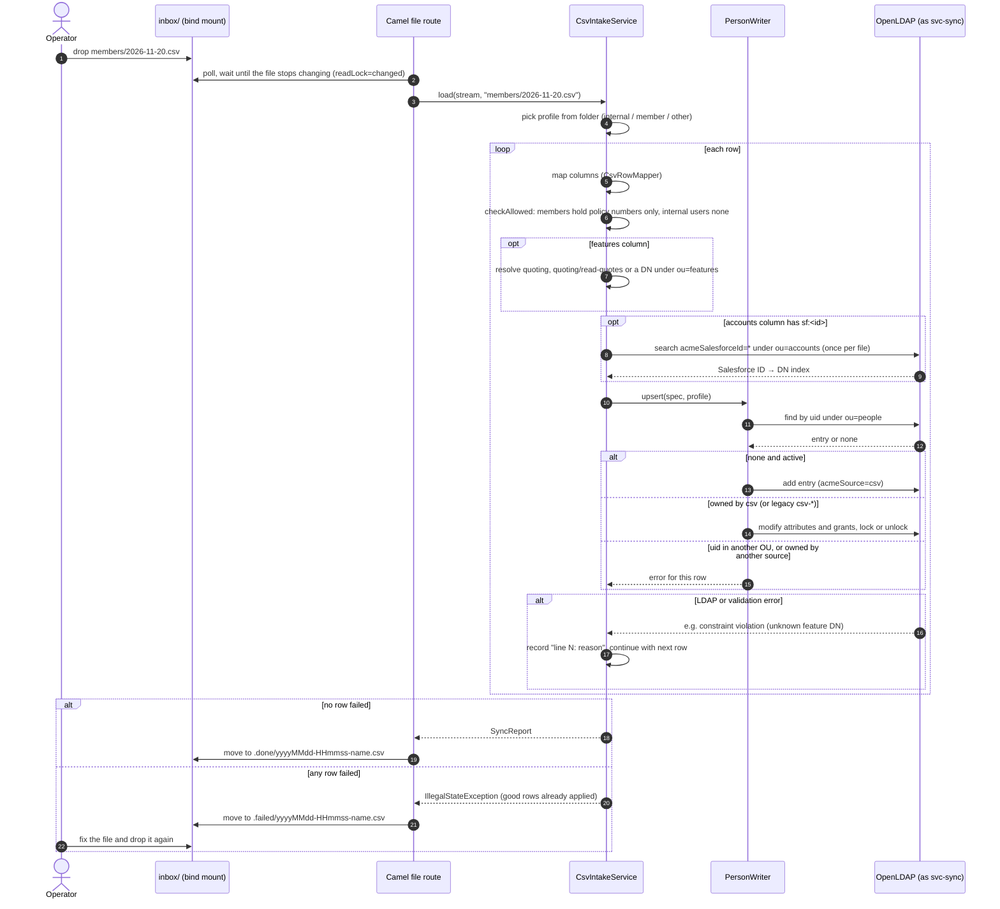

# CSV intake

Internal users, members (insureds) and other users are not in Salesforce. Until
they have their own sources, they come from CSV files dropped into
`inbox/internal`, `inbox/members` or `inbox/other`. The folder decides the user
type. The route is `backend/src/main/resources/routes/csv-intake.camel.yaml`, and the
logic is in `CsvIntakeService`.

Every row is an upsert, so dropping the same file again is safe. A row with
`active=false` locks the entry, and rows never delete anything. All three feeds
write `acmeSource=csv`.

## Who may hold what

| Folder | `acmeUserType` | Object classes added | Allowed grants |
|---|---|---|---|
| `internal/` | internal | `acmeFeatureAccess`, `acmeAccountAccess` | features, accounts |
| `members/` | member | `acmeMemberAccess` | policy numbers only |
| `other/` | other | all three | features, accounts, policy numbers |

Agents are never loaded from CSV: they come from Salesforce
([salesforce-sync.md](salesforce-sync.md)).
