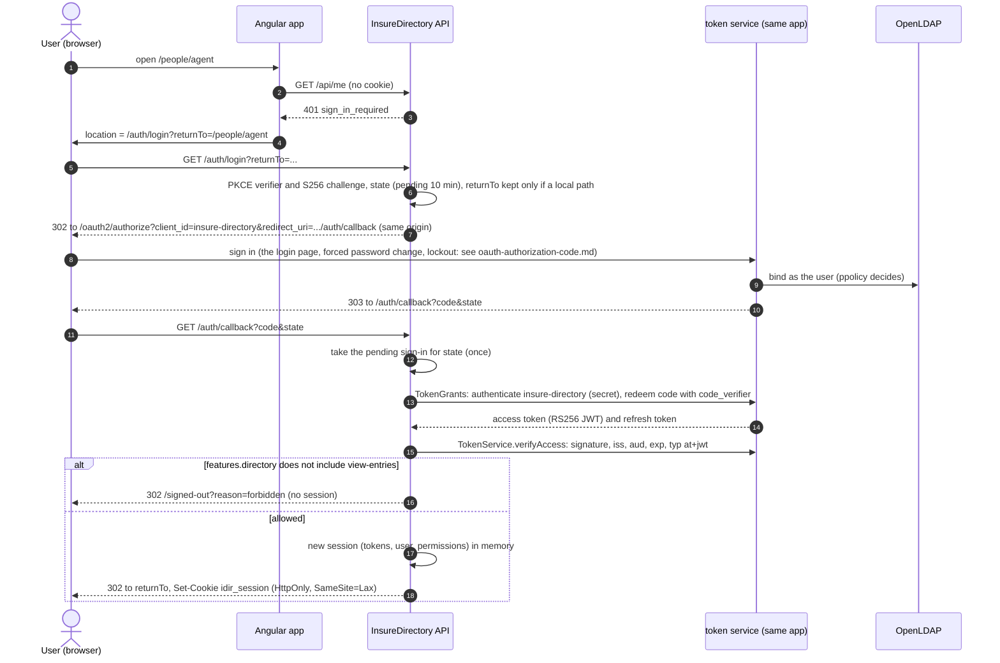
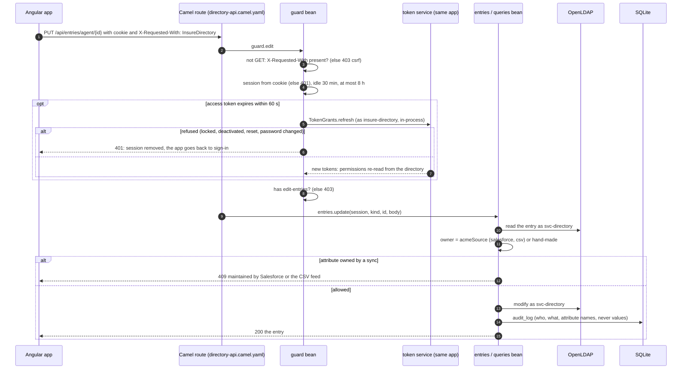

# InsureDirectory: sign-in and an API call

InsureDirectory is the directory maintenance app for customer service and developers.
The Angular app (`frontend/`) and its API (part of the backend, with Camel REST DSL
routes in `routes/directory-api.camel.yaml`) are served by the backend from one origin,
http://localhost:8080, together with the token service.

The API is the OAuth client, not the browser (a backend for frontend). It is the
confidential client `insure-directory`. Because the token service runs in the same app,
the API redeems the code and refreshes in-process through `TokenGrants`, the same code
behind `POST /oauth2/token`: it authenticates with its secret and gets the same checks.
The tokens never reach the browser, which holds only a random session ID in the HttpOnly
cookie `idir_session`. The code is in `backend/src/main/java/com/acmeinsurance/directory/auth/`
(`AuthFlow`, `Guard`, `OAuthClient`, `SessionStore`).

## Sign-in

Permissions come from the token's `features` claim, under the `directory` feature
(`cn=directory,ou=features`): `view-entries` to use the app, `edit-entries` to change
entries, and `run-queries` for the query builder. A grant of the feature itself grants
all three.

## An API call

## What an entry's source allows

| Entry | Can change here |
|---|---|
| Hand-made (`acmeSource=manual` or none) | Everything except the RDN; can be deleted when it has no children |
| Salesforce agent | Feature grants (`acmeFeatureDN`) only |
| Salesforce agreement | Its underwriting company, unless `SF_MANAGES_UNDERWRITING_COMPANY=true` |
| CSV-fed person | Nothing; change the CSV feed |
| Any person | Lock, unlock (not when `acmeDeactivated`), reset password |

A password reset sets a random temporary password and `pwdReset: TRUE` in one
operation, so the person must change it at the next sign-in. The password is shown
once and never stored or logged.
