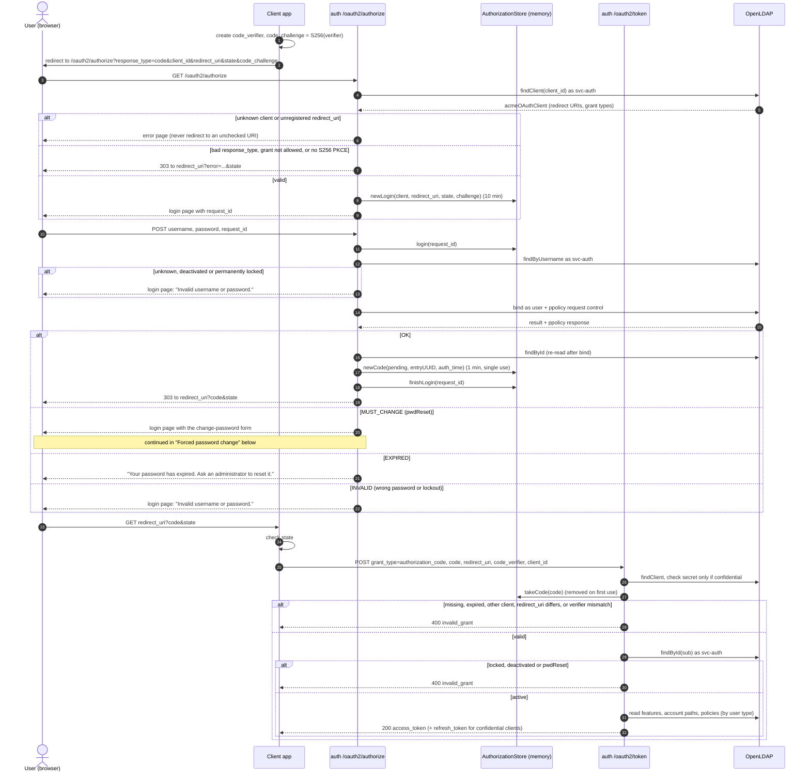
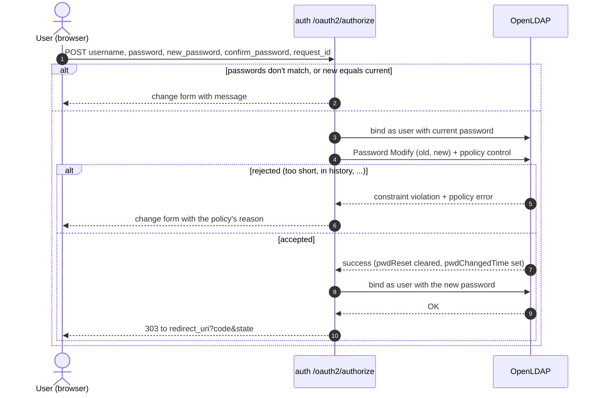

# OAuth: authorization code with PKCE

The flow for browser and single-page applications (for example the public sample
client `demo-spa`). It follows RFC 6749 section 4.1 with PKCE (RFC 7636), and only
`S256` is accepted. There is no consent screen, because every client is an Acme
Insurance application. The code is in `auth/src/main/java/com/acmeinsurance/auth/web/AuthorizeResource.java`
and `TokenResource.java`.

The service never checks a password itself. It binds to OpenLDAP as the user and
reads the ppolicy response control, so the password policy decides lockout,
expiry and forced changes.

## Sign-in and code exchange

## Forced password change

After an administrator resets a password (with `pwdReset: TRUE`), ppolicy only
allows the user to change it. The login page offers that change, made as the user
with the Password Modify extended operation, so the password policy still checks
the new password's quality and history.

## Token contents

| Claim | Present for |
|---|---|
| `sub` (entryUUID), `preferred_username`, `name`, `email`, `user_type`, `auth_time`, `client_id` | everyone |
| `features` (feature → permissions) | agent, internal, other |
| `accounts` (agency-rooted paths of held grants) | agent, internal, other |
| `policies` (policy numbers) | member, other |

The user types for each claim are set by `auth.claims.*` in
`auth/src/main/resources/application.properties`. See also
[oauth-refresh-token.md](oauth-refresh-token.md) and
[oauth-password-grant.md](oauth-password-grant.md).
