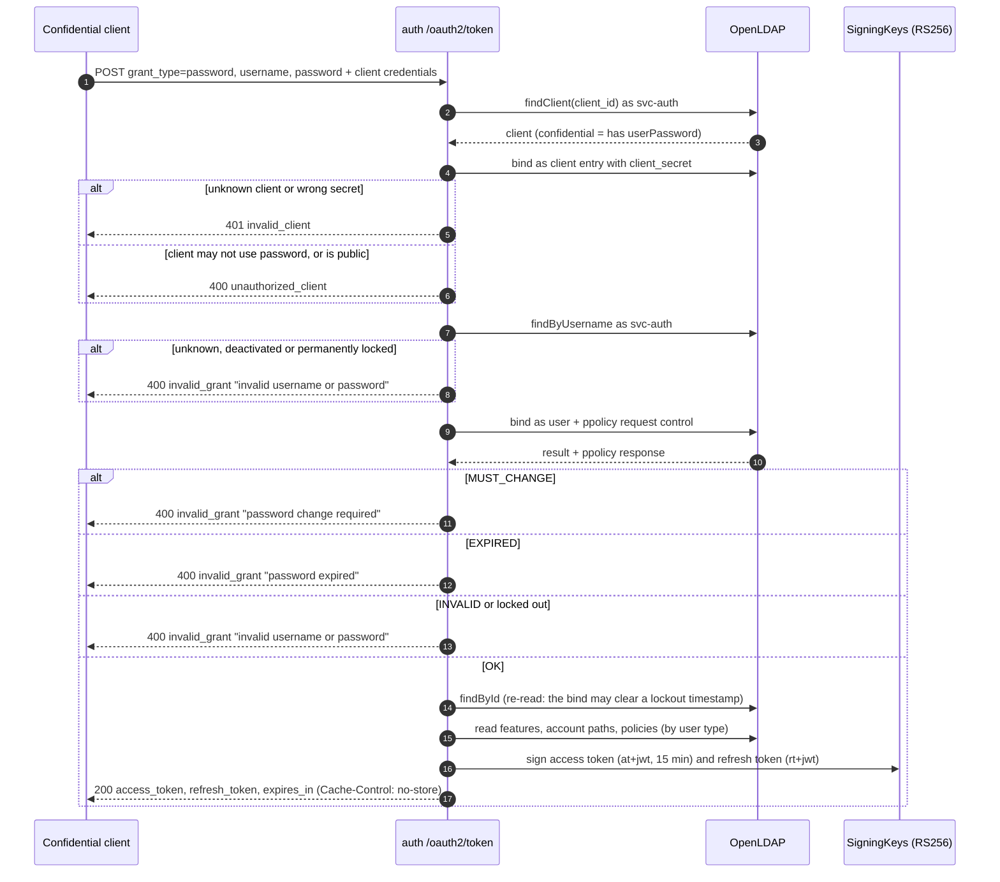

# OAuth: password grant

For trusted server-side applications only: the password grant needs a
**confidential** client (an `acmeOAuthClient` with a `userPassword`). The client
authenticates with HTTP Basic (`client_secret_basic`) or form parameters
(`client_secret_post`), never both. Its secret is checked by binding as the client
entry. The code is in `TokenResource.password()`.

A user who must change their password can't get a token this way. They have to
sign in through the [authorization code flow](oauth-authorization-code.md), whose
login page handles the change.

