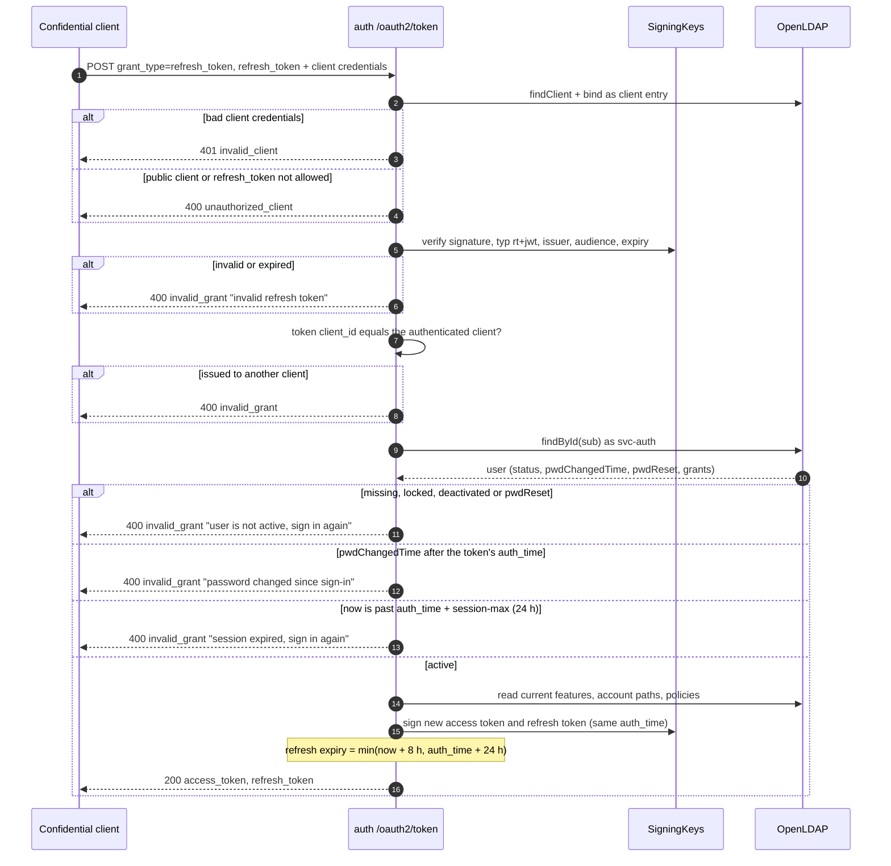

# OAuth: refresh token

Refresh tokens are stateless JWTs (`typ rt+jwt`, audience = the issuer), signed
with the same key as access tokens. They are issued only to **confidential**
clients that are allowed the `refresh_token` grant. Public clients such as
`demo-spa` never get one.

A refresh is not a blind re-sign: the service reads the user from LDAP again,
so locks, deactivation, resets, password changes and new grants take effect
at the next refresh (within 15 minutes, the access token lifetime).

## Lifetimes

| Setting | Default | Meaning |
|---|---|---|
| `auth.tokens.access-ttl` | 15 min | Access token lifetime |
| `auth.tokens.refresh-ttl` | 8 h | Refresh token lifetime (sliding) |
| `auth.tokens.session-max` | 24 h | Hard limit from the original sign-in (`auth_time`) |
| `auth.tokens.code-ttl` | 1 min | Authorization code lifetime |
| `auth.tokens.login-ttl` | 10 min | How long a login page stays valid |

Resource servers verify access tokens offline with the keys published at
`/oauth2/jwks`. The issuer's metadata is at `/.well-known/oauth-authorization-server`.
