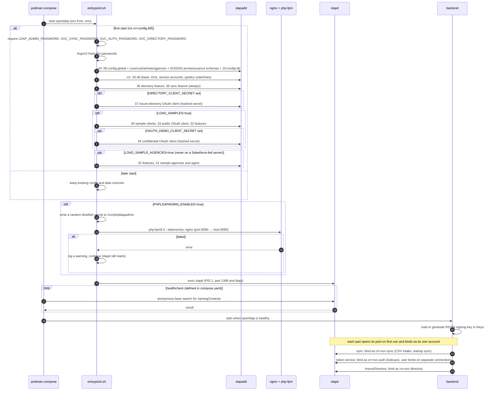
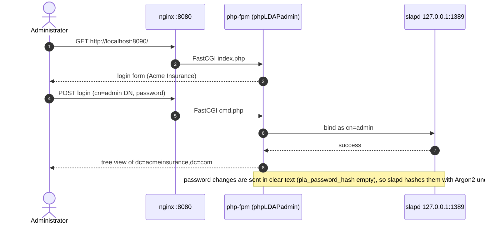

# OpenLDAP container startup

What `openldap/entrypoint.sh` does when the container starts, and how the other
services wait for it. On first start, the configuration and the directory tree are
built offline with `slapadd`. Later starts reuse the volumes as they are.

## phpLDAPadmin sign-in

phpLDAPadmin runs in the same container and talks to slapd over the loopback
interface. It uses cookie authentication: the bind password is kept in a browser
cookie, encrypted with a random key that is generated at every container start.
Restarting the container therefore signs everyone out.

