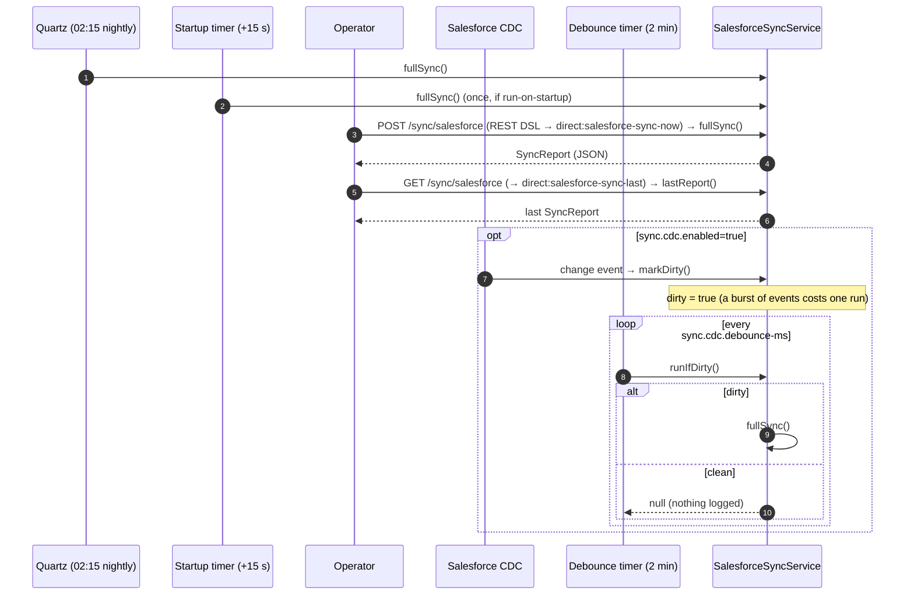
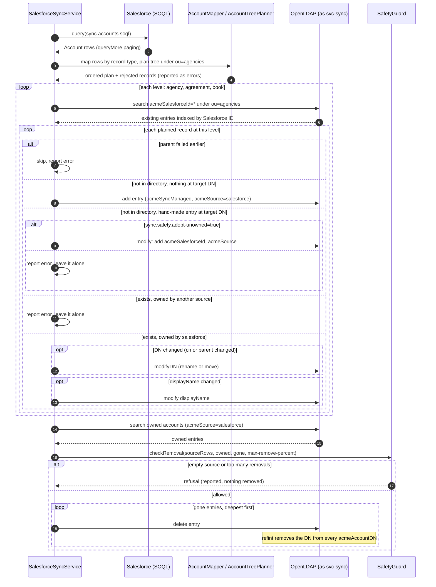
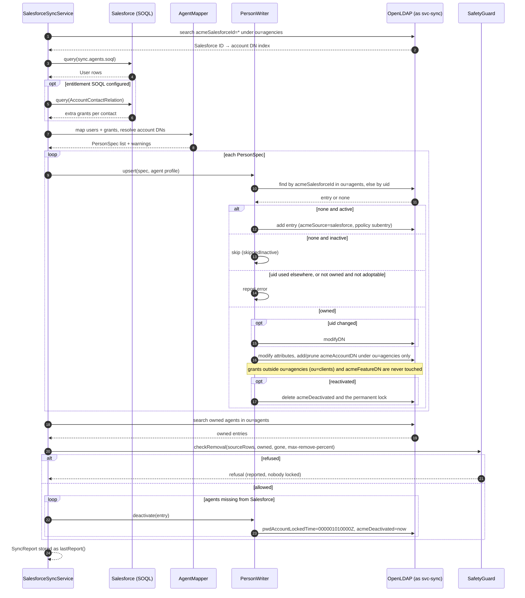

# Salesforce sync

How Salesforce Accounts and Users reach the directory. All of the logic is in
`SalesforceSyncService` (`sync/src/main/java/com/acmeinsurance/ldapsync/salesforce/`).
The Camel routes in `sync/src/main/resources/routes/salesforce-sync.camel.yaml`
only decide when it runs. With `SF_ENABLED=false`, none of these routes is created, and
`/sync/salesforce` answers 503 with a `disabled` status.

The HTTP trigger is a Camel REST DSL endpoint, which forwards to a `direct:` route.
Camel generates its OpenAPI document from that definition and serves it at
`http://localhost:8080/openapi`, with Swagger UI at `http://localhost:8080/q/swagger-ui/`.

## Triggers

Every trigger calls the same `fullSync()`. It is a complete, idempotent comparison,
so running it more often is always safe. A lock means only one run happens at a
time, and a trigger that arrives during a run is skipped.

## Full sync: agencies, agreements and books

Accounts are written level by level (agency, then agreement, then book), and the
directory is re-read before each level, so a child is always placed under its
parent's current DN. If a record can't be written, its children are skipped.

## Full sync: brokers and agents

People are written through `PersonWriter`, which applies the ownership rule. Agents
who no longer come back from Salesforce are locked, never deleted.

